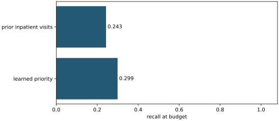

# Readmission ranking under a fixed outreach budget (simulation)

Recall at a 10% outreach budget for utilization vs learned ranking was 0.2431 vs 0.2994 across three seeds.



## Study design

Compare ranking by prior inpatient visits with a gradient-boosted ranker using eight encounter measurements. Hold out 25% of people in each split. Measure the fraction of positive encounters captured in the top 10% and the positive fraction within that budget. Generate two encounters per simulated patient with overlapping predictors and patient-level frailty.

Independent portfolio experiment inspired by work from Don Adjeroh. [Research source](https://community.wvu.edu/~daadjeroh/)

## Results

| Method | auroc | average_precision | recall_at_budget | precision_at_budget |
|---|---:|---:|---:|---:|
| prior inpatient visits | 0.6807 | 0.2775 | 0.2431 | 0.3836 |
| learned priority | 0.7718 | 0.4057 | 0.2994 | 0.4718 |

Per-seed results are in [results.json](results.json).

## Reproduce

Local CPU run, Python 3.10. Model checkpoints are generated during training. Set PORTFOLIO_DATA to reuse an existing data directory.

```sh
python -m pip install -r requirements.txt
python train.py
```

[Training notebook](reproduce.ipynb)
