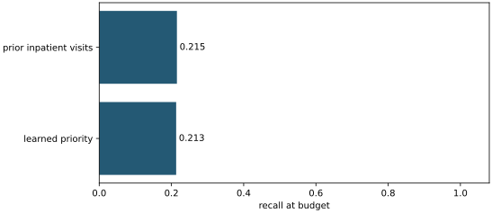

# Readmission ranking under a fixed outreach budget (public data)

Recall at a 10% outreach budget for utilization vs learned ranking was 0.2152 vs 0.2131 across three seeds.



## Study design

Compare ranking by prior inpatient visits with a gradient-boosted ranker using eight encounter measurements. Hold out 25% of people in each split. Measure the fraction of positive encounters captured in the top 10% and the positive fraction within that budget. Use the UCI Diabetes 130-US Hospitals encounter cohort, filtering discharge categories for hospice or death. Split by patient identifier. The positive outcome is a recorded readmission within 30 days. The experiment tests prioritization and does not estimate whether outreach prevents readmission.

Independent portfolio experiment inspired by work from Don Adjeroh. [Research source](https://community.wvu.edu/~daadjeroh/)

[Public dataset](https://archive.ics.uci.edu/dataset/296/diabetes+130-us+hospitals+for+years+1999-2008)

## Results

| Method | auroc | average_precision | recall_at_budget | precision_at_budget |
|---|---:|---:|---:|---:|
| prior inpatient visits | 0.6064 | 0.1831 | 0.2152 | 0.2508 |
| learned priority | 0.6371 | 0.2089 | 0.2131 | 0.2483 |

Per-seed results are in [results.json](results.json).

## Reproduce

Local CPU run, Python 3.10. Model checkpoints are generated during training. Set PORTFOLIO_DATA to reuse an existing data directory.

```sh
python -m pip install -r requirements.txt
python prepare.py
python train.py
```

[Training notebook](reproduce.ipynb)
