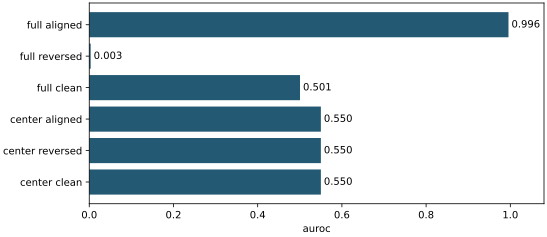

# Case-based breast image classification (simulation)

AUROC under reversed corner artifacts, full image vs masked corner was 0.003 vs 0.550 across three seeds.



## Study design

Fit a whitening transform on training cases. Classify each query by the difference in mean distance to its five nearest cases from each class, with logistic calibration on a separate subset. Compare all pixels with a version that masks the top-left corner. Add a label-correlated corner artifact in training, then evaluate aligned, clean and reversed conditions. The nearest-case mechanism follows the rationale of the mammography paper and uses whole-image descriptors. Generate independent lesion phantoms with shape and texture cues. The corner artifact is generated separately from the lesion.

Independent portfolio experiment inspired by work from Alina Jade Barnett. [Research source](https://www.nature.com/articles/s42256-021-00423-x)

## Results

| Method | auroc | average_precision |
|---|---:|---:|
| full aligned | 0.9957 | 0.9955 |
| full reversed | 0.0034 | 0.3117 |
| full clean | 0.5005 | 0.5014 |
| center aligned | 0.5501 | 0.5555 |
| center reversed | 0.5501 | 0.5555 |
| center clean | 0.5501 | 0.5555 |

Per-seed results are in [results.json](results.json).

## Reproduce

Local CPU run, Python 3.10. Model checkpoints are generated during training. Set PORTFOLIO_DATA to reuse an existing data directory.

```sh
python -m pip install -r requirements.txt
python train.py
```

[Training notebook](reproduce.ipynb)
