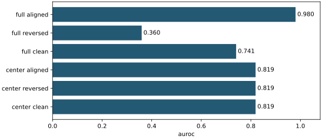

# Case-based breast image classification (public data)

AUROC under reversed corner artifacts, full image vs masked corner was 0.360 vs 0.819 across three seeds. The test uses artificially added artifacts on real ultrasound images.



## Study design

Fit a whitening transform on training cases. Classify each query by the difference in mean distance to its five nearest cases from each class, with logistic calibration on a separate subset. Compare all pixels with a version that masks the top-left corner. Add a label-correlated corner artifact in training, then evaluate aligned, clean and reversed conditions. The nearest-case mechanism follows the rationale of the mammography paper and uses whole-image descriptors. Use BreastMNIST breast ultrasound with 546 train and 156 test images on the official split. Compare malignant with benign or normal. Both the modality and the imposed artifact differ from the cited mammography paper.

Independent portfolio experiment inspired by work from Alina Jade Barnett. [Research source](https://www.nature.com/articles/s42256-021-00423-x)

[Public dataset](https://medmnist.com/)

## Results

| Method | auroc | average_precision |
|---|---:|---:|
| full aligned | 0.9804 | 0.9585 |
| full reversed | 0.3596 | 0.2081 |
| full clean | 0.7407 | 0.5041 |
| center aligned | 0.8192 | 0.6730 |
| center reversed | 0.8192 | 0.6730 |
| center clean | 0.8192 | 0.6730 |

Per-seed results are in [results.json](results.json).

## Reproduce

Local CPU run, Python 3.10. Model checkpoints are generated during training. Set PORTFOLIO_DATA to reuse an existing data directory.

```sh
python -m pip install -r requirements.txt
python prepare.py
python train.py
```

[Training notebook](reproduce.ipynb)
