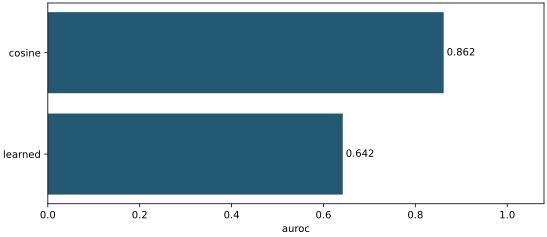

# Multimodal pair verification (simulation)

AUROC for cosine similarity vs learned verification was 0.8616 vs 0.6420 across three seeds.



## Study design

Train a regularized pair verifier on matching pairs, harder negatives selected by cosine similarity, and random negatives. Compare against cosine similarity across every held-out pair. Report AUROC, average precision and image-to-text Recall@5. Generate noisy paired observations with both shared group structure and shared instance-level information.

Independent portfolio experiment inspired by work from Chongle Pan. [Research source](https://www.ou.edu/coe/sbme/people/faculty/chongle-pan)

## Results

| Method | auroc | average_precision | recall_at_5 |
|---|---:|---:|---:|
| cosine | 0.8616 | 0.0954 | 0.5354 |
| learned | 0.6420 | 0.0106 | 0.0604 |

Per-seed results are in [results.json](results.json).

## Reproduce

Local CPU run, Python 3.10. Model checkpoints are generated during training. Set PORTFOLIO_DATA to reuse an existing data directory.

```sh
python -m pip install -r requirements.txt
python train.py
```

[Training notebook](reproduce.ipynb)
