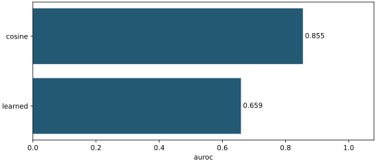

# Multimodal pair verification (public data)

AUROC for cosine similarity vs learned verification was 0.8551 vs 0.6589 across three seeds.



## Study design

Train a regularized pair verifier on matching pairs, harder negatives selected by cosine similarity, and random negatives. Compare against cosine similarity across every held-out pair. Report AUROC, average precision and image-to-text Recall@5. Use the official 200 training pairs and 80 test pairs sampled from Radiology_mini with the cached frozen CLIP encoder. All three fits share one test gallery. The task links an image to its source caption.

Independent portfolio experiment inspired by work from Chongle Pan. [Research source](https://www.ou.edu/coe/sbme/people/faculty/chongle-pan)

[Public dataset](https://huggingface.co/datasets/unsloth/Radiology_mini)

## Results

| Method | auroc | average_precision | recall_at_5 |
|---|---:|---:|---:|
| cosine | 0.8551 | 0.1184 | 0.5000 |
| learned | 0.6589 | 0.0263 | 0.1333 |

Per-seed results are in [results.json](results.json).

## Reproduce

Local CPU run, Python 3.10. Model checkpoints are generated during training. Set PORTFOLIO_DATA to reuse an existing data directory.

```sh
python -m pip install -r requirements.txt
python prepare.py
python train.py
```

[Training notebook](reproduce.ipynb)
