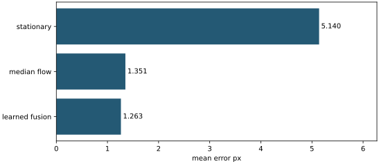

# Motion tracking under simulated deformation

Mean centroid error in pixels, median flow vs learned fusion across three splits was 1.3509 vs 1.2634.



## Study design

Use frozen Farneback optical flow and phase correlation features to fit a regularized model for centroid displacement. Compare against no motion and median foreground flow. The first frame's ground-truth mask supplies foreground pixels. This is pairwise foreground-centroid prediction with a known starting mask. Render objects with changing position, shape and appearance on randomized backgrounds. Hold out entire background groups. The dataset passed filters for 1152 pairs from 72 groups.

Independent portfolio experiment inspired by work from Jinwei Ye. [Research source](https://ieeexplore.ieee.org/document/10684001/)

## Results

| Method | mean_error_px | median_error_px | test_sequences | test_pairs |
|---|---:|---:|---:|---:|
| stationary | 5.1396 | 4.6841 | 21.0000 | 336.0000 |
| median flow | 1.3509 | 0.5338 | 21.0000 | 336.0000 |
| learned fusion | 1.2634 | 0.5348 | 21.0000 | 336.0000 |

Per-seed results are in [results.json](results.json).

## Reproduce

Local CPU run, Python 3.10. Model checkpoints are generated during training. Set PORTFOLIO_DATA to reuse an existing data directory.

```sh
python -m pip install -r requirements.txt
python train.py
```

[Training notebook](reproduce.ipynb)
