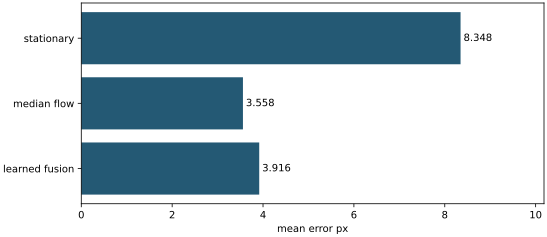

# Kvasir polyp centroid tracking under controlled motion

Mean centroid error in pixels, median flow vs learned fusion across three splits was 3.5580 vs 3.9163. Real endoscopy images with simulated motion.



## Study design

Use frozen Farneback optical flow and phase correlation features to fit a regularized model for centroid displacement. Compare against no motion and median foreground flow. The first frame's ground-truth mask supplies foreground pixels. This is pairwise foreground-centroid prediction with a known starting mask. Use real endoscopy images and annotated polyp masks from Kvasir-SEG. Resize to 160 × 96 and apply controlled affine changes, exposure changes and noise. Hold out source images so no transformed copy of a test image appears in training. Motion is simulated. The dataset passed filters for 1260 pairs from 420 groups.

Independent portfolio experiment inspired by work from Jinwei Ye. [Research source](https://ieeexplore.ieee.org/document/10684001/)

[Public dataset](https://datasets.simula.no/kvasir-seg/)

## Results

| Method | mean_error_px | median_error_px | test_sequences | test_pairs |
|---|---:|---:|---:|---:|
| stationary | 8.3476 | 7.7238 | 118.0000 | 354.0000 |
| median flow | 3.5580 | 0.9406 | 118.0000 | 354.0000 |
| learned fusion | 3.9163 | 2.3587 | 118.0000 | 354.0000 |

Per-seed results are in [results.json](results.json).

## Reproduce

Local CPU run, Python 3.10. Model checkpoints are generated during training. Set PORTFOLIO_DATA to reuse an existing data directory.

```sh
python -m pip install -r requirements.txt
python prepare.py
python train.py
```

[Training notebook](reproduce.ipynb)
