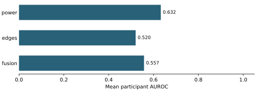

# Motor imagery decoding from EEG power and connectivity

Does adding correlations between electrodes improve left-versus-right motor imagery decoding for unseen participants?

## Result

Mean participant AUROC was 0.632 for power alone, 0.520 for edges alone and 0.557 for fusion. The paired participant-bootstrap 95% interval for fusion minus power was −0.136 to −0.021. These sensor-level correlations come from EEG. The subset contains 16 participants, and the bootstrap conditions on the fitted folds.



## Experiment

PhysioNet EEGMMIDB participants 1–16 contribute 480 trials across runs 4 and 8. Three frequency bands and 21 sensorimotor electrodes yield 63 power and 630 correlation features. A four-fold outer split holds out entire people. Three inner participant folds tune logistic regularization. Each person receives equal weight in the reported metrics.

Independent portfolio project connected to [Liu and colleagues’ DICCCOL study of structural and functional cortical architecture](https://pmc.ncbi.nlm.nih.gov/articles/PMC3593574/).

Data and attribution: [PhysioNet EEG Motor Movement/Imagery Dataset v1.0.0](https://physionet.org/content/eegmmidb/1.0.0/).

## Held-out metrics

| Method and condition | auroc | balanced accuracy |
|---|---:|---:|
| power | 0.6323 | 0.5519 |
| edges | 0.5201 | 0.5199 |
| fusion | 0.5575 | 0.5486 |

Individual seeds or folds and the evaluation details are in [results.json](results.json).

## Reproduce

Run in this folder with Python 3.10.11. The original runs used a local CPU. Model parameters are saved to the checkpoints directory on training.

```sh
python -m pip install -r requirements.txt
python download.py
python train.py
```

[Open the reproduction notebook](reproduce.ipynb) · [Training source](train.py)
