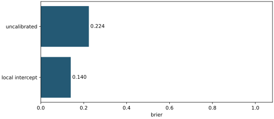

# Calibration across clinical sites (simulation)

Brier score (original vs locally calibrated predictions): 0.2241 vs 0.1396, averaged over three seeds.



## Study design

Hold out each site in turn. Fit logistic regression on the other sites using 100 rounds of sample-weighted gradient aggregation. Training-site medians and scaling parameters are pooled in this simulation. Compare the original model with a locally fitted intercept using 30% of the held-out site's records. Evaluate on the disjoint 70% and weight sites equally. Lower Brier score is better. Generate four sites with 500 records each, different baseline disease rates and a shared feature effect.

Independent portfolio experiment inspired by work from Sanjay Purushotham. [Research source](https://sanjayp.is.umbc.edu/)

## Results

| Method | brier | absolute_prevalence_error |
|---|---:|---:|
| uncalibrated | 0.2241 | 0.2592 |
| local intercept | 0.1396 | 0.0370 |

Per-seed results are in [results.json](results.json).

## Reproduce

Local CPU run, Python 3.10. Model checkpoints are generated during training. Set PORTFOLIO_DATA to reuse an existing data directory.

```sh
python -m pip install -r requirements.txt
python train.py
```

[Training notebook](reproduce.ipynb)
