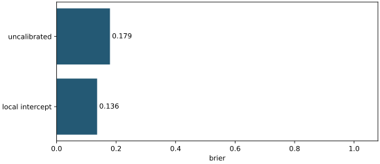

# Calibration across clinical sites (public data)

Brier score (original vs locally calibrated predictions): 0.1794 vs 0.1362, averaged over three seeds.



## Study design

Hold out each site in turn. Fit logistic regression on the other sites using 100 rounds of sample-weighted gradient aggregation. Training-site medians and scaling parameters are pooled in this simulation. Compare the original model with a locally fitted intercept using 30% of the held-out site's records. Evaluate on the disjoint 70% and weight sites equally. Lower Brier score is better. The UCI cohort has 920 records across Cleveland, Hungary, Switzerland and Long Beach VA. Disease presence is the binary outcome. All four centers participate as held-out sites. This experiment simulates clients locally and measures calibration with labeled target-site records.

Independent portfolio experiment inspired by work from Sanjay Purushotham. [Research source](https://sanjayp.is.umbc.edu/)

[Public dataset](https://archive.ics.uci.edu/dataset/45/heart+disease)

## Results

| Method | brier | absolute_prevalence_error |
|---|---:|---:|
| uncalibrated | 0.1794 | 0.1582 |
| local intercept | 0.1362 | 0.0604 |

Per-seed results are in [results.json](results.json).

## Reproduce

Local CPU run, Python 3.10. Model checkpoints are generated during training. Set PORTFOLIO_DATA to reuse an existing data directory.

```sh
python -m pip install -r requirements.txt
python prepare.py
python train.py
```

[Training notebook](reproduce.ipynb)
