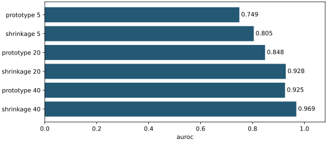

# Few-shot retinal severity classification (simulation)

AUROC (prototype vs shrinkage with 20 labels per class): 0.8484 vs 0.9280, averaged over three seeds.



## Study design

Estimate a 24-component whitened representation from unlabeled training features. Give the classifier 5, 20 or 40 labeled examples per class. Compare nearest-centroid scores with shrinkage linear discriminant analysis on held-out cases. The comparison below uses 20 examples per class. Generate five ordered severity grades along a latent feature direction with correlated nuisance variation. Train on 2,200 synthetic examples and evaluate on 800 held-out samples.

Independent portfolio experiment inspired by work from Nuno Vasconcelos. [Research source](https://vision.ucsd.edu/publications)

## Results

| Method | auroc | average_precision |
|---|---:|---:|
| prototype 5 | 0.7494 | 0.8109 |
| shrinkage 5 | 0.8050 | 0.8592 |
| prototype 20 | 0.8484 | 0.8982 |
| shrinkage 20 | 0.9280 | 0.9542 |
| prototype 40 | 0.9252 | 0.9505 |
| shrinkage 40 | 0.9687 | 0.9799 |

Per-seed results are in [results.json](results.json).

## Reproduce

Local CPU run, Python 3.10. Model checkpoints are generated during training. Set PORTFOLIO_DATA to reuse an existing data directory.

```sh
python -m pip install -r requirements.txt
python train.py
```

[Training notebook](reproduce.ipynb)
