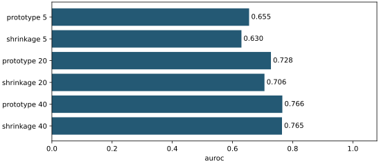

# Few-shot retinal severity classification (public data)

AUROC (prototype vs shrinkage with 20 labels per class): 0.7278 vs 0.7064, averaged over three seeds.



## Study design

Estimate a 24-component whitened representation from unlabeled training features. Give the classifier 5, 20 or 40 labeled examples per class. Compare nearest-centroid scores with shrinkage linear discriminant analysis on held-out cases. The comparison below uses 20 examples per class. RetinaMNIST provides 1,080 training and 400 official test images. Classes 2–4 form the positive group and classes 0–1 the negative group. The outcome is diabetic retinopathy severity. The connection to glaucoma research is the few-shot learning question.

Independent portfolio experiment inspired by work from Nuno Vasconcelos. [Research source](https://vision.ucsd.edu/publications)

[Public dataset](https://medmnist.com/)

## Results

| Method | auroc | average_precision |
|---|---:|---:|
| prototype 5 | 0.6553 | 0.5869 |
| shrinkage 5 | 0.6298 | 0.5729 |
| prototype 20 | 0.7278 | 0.6387 |
| shrinkage 20 | 0.7064 | 0.6303 |
| prototype 40 | 0.7657 | 0.6734 |
| shrinkage 40 | 0.7646 | 0.6655 |

Per-seed results are in [results.json](results.json).

## Reproduce

Local CPU run, Python 3.10. Model checkpoints are generated during training. Set PORTFOLIO_DATA to reuse an existing data directory.

```sh
python -m pip install -r requirements.txt
python prepare.py
python train.py
```

[Training notebook](reproduce.ipynb)
