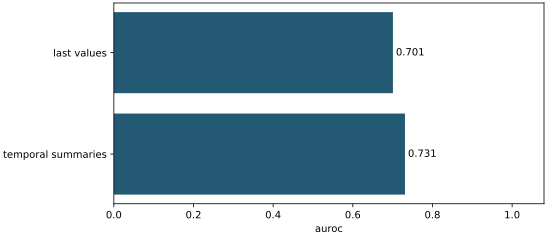

# Early warning from simulated vital signs

AUROC, last values vs temporal summaries across three splits was 0.7007 vs 0.7310.



## Study design

Compare gradient boosting with eight last-measured vitals against the same model with per-vital averages, variability, changes between time windows and observation counts. Report AUROC, average precision and Brier score on stratified 25% patient holdouts. Generate 3,200 independent simulated patient trajectories per seed. Event probability depends on a latent level and temporal drift.

Independent portfolio experiment inspired by work from Zoran Obradovic. [Research source](https://dabi.temple.edu/projects/predictive-modeling-of-patient-state-and-therapy-optimization/)

## Results

| Method | auroc | average_precision | brier |
|---|---:|---:|---:|
| last values | 0.7007 | 0.4097 | 0.1660 |
| temporal summaries | 0.7310 | 0.4441 | 0.1608 |

Per-seed results are in [results.json](results.json).

## Reproduce

Local CPU run, Python 3.10. Model checkpoints are generated during training. Set PORTFOLIO_DATA to reuse an existing data directory.

```sh
python -m pip install -r requirements.txt
python train.py
```

[Training notebook](reproduce.ipynb)
