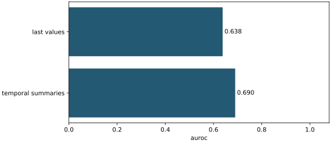

# Early ICU mortality risk with temporal vitals

AUROC, last values vs temporal summaries across three splits was 0.6379 vs 0.6900.



## Study design

Compare gradient boosting with eight last-measured vitals against the same model with per-vital averages, variability, changes between time windows and observation counts. Report AUROC, average precision and Brier score on stratified 25% patient holdouts. Use 4,000 ICU stays from PhysioNet Challenge 2012 Set A, with measurements through ICU hour 24 and in-hospital mortality labels. This evaluates retrospective risk ranking, including the effect of measurement frequency. The three random splits can overlap.

Independent portfolio experiment inspired by work from Zoran Obradovic. [Research source](https://dabi.temple.edu/projects/predictive-modeling-of-patient-state-and-therapy-optimization/)

[Public dataset](https://physionet.org/content/challenge-2012/1.0.0/)

## Results

| Method | auroc | average_precision | brier |
|---|---:|---:|---:|
| last values | 0.6379 | 0.2255 | 0.1183 |
| temporal summaries | 0.6900 | 0.2538 | 0.1173 |

Per-seed results are in [results.json](results.json).

## Reproduce

Local CPU run, Python 3.10. Model checkpoints are generated during training. Set PORTFOLIO_DATA to reuse an existing data directory.

```sh
python -m pip install -r requirements.txt
python prepare.py
python train.py
```

[Training notebook](reproduce.ipynb)
