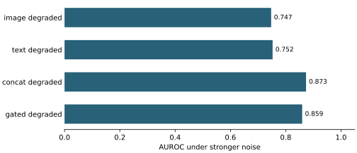

# Image and text fusion under noisy measurements

When does learned gating help combine two incomplete measurements?

## Result

Under stronger noise, plain concatenation reached 0.873 AUROC, learned gating 0.859, and the best single stream 0.752. These are simulated feature vectors. The ablations measure predictive contribution in this generator.



## Experiment

Three seeds each generate 4,800 training, 800 validation and 1,600 held-out examples from paired latent measurements. Each stream gets an independent 32-dimensional projection. Four neural models train for 16 epochs. Validation loss selects the epoch. The stress test raises the probability of a degraded stream from 22% to 55%.

Independent portfolio project connected to [Ye’s retinal image-captioning work, GCS-M3VLT](https://sites.google.com/view/donghyeye).

## Held-out metrics

| Method and condition | auroc | brier |
|---|---:|---:|
| image clean | 0.7690 | 0.1963 |
| image degraded | 0.7472 | 0.2048 |
| text clean | 0.7711 | 0.1959 |
| text degraded | 0.7524 | 0.2022 |
| concat clean | 0.9120 | 0.1228 |
| concat degraded | 0.8734 | 0.1525 |
| gated clean | 0.8908 | 0.1367 |
| gated degraded | 0.8594 | 0.1565 |

Individual seeds or folds and the evaluation details are in [results.json](results.json).

## Reproduce

Run in this folder with Python 3.10.11. The original runs used a local CPU. Model parameters are saved to the checkpoints directory on training.

```sh
python -m pip install -r requirements.txt
python train.py
```

[Open the reproduction notebook](reproduce.ipynb) · [Training source](train.py)
