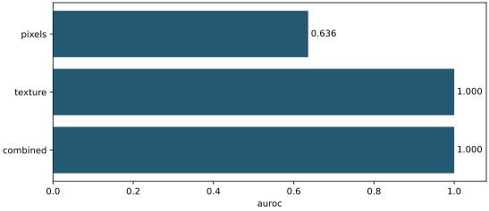

# Interpretable ultrasound texture classification (simulation)

Held-out AUROC (pixels vs pixels plus texture features): 0.636 vs 1.000, averaged over three seeds.



## Study design

Compare raw pixels, 54 interpretable texture summaries, and their combination using the same regularized classifier. The summaries measure intensities, residuals and gradient magnitudes at three spatial scales across the full image and central crop. Repeat with three stratified 85% training subsamples. Each seed generates 1,800 training and 600 held-out phantoms. The generator varies texture and elongation by class. It supplies a controlled test of feature sensitivity.

Independent portfolio experiment inspired by work from Min Xian. [Research source](https://imci.uidaho.edu/deep-learning-for-breast-ultrasound-tumor-detection/)

## Results

| Method | auroc | balanced_accuracy |
|---|---:|---:|
| pixels | 0.6360 | 0.6421 |
| texture | 1.0000 | 1.0000 |
| combined | 1.0000 | 1.0000 |

Per-seed results are in [results.json](results.json).

## Reproduce

Local CPU run, Python 3.10. Model checkpoints are generated during training. Set PORTFOLIO_DATA to reuse an existing data directory.

```sh
python -m pip install -r requirements.txt
python train.py
```

[Training notebook](reproduce.ipynb)
