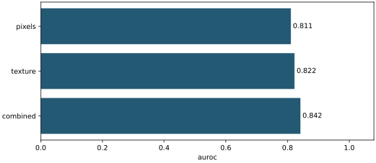

# Interpretable ultrasound texture classification (public data)

Held-out AUROC (pixels vs pixels plus texture features): 0.811 vs 0.842, averaged over three seeds.



## Study design

Compare raw pixels, 54 interpretable texture summaries, and their combination using the same regularized classifier. The summaries measure intensities, residuals and gradient magnitudes at three spatial scales across the full image and central crop. Repeat with three stratified 85% training subsamples. BreastMNIST supplies 546 training and 156 official test images. Normal and benign cases share label 1. Texture features are image statistics without radiologist BI-RADS annotations. The held-out set is shared by all three fits.

Independent portfolio experiment inspired by work from Min Xian. [Research source](https://imci.uidaho.edu/deep-learning-for-breast-ultrasound-tumor-detection/)

[Public dataset](https://zenodo.org/records/10519652)

## Results

| Method | auroc | balanced_accuracy |
|---|---:|---:|
| pixels | 0.8108 | 0.6957 |
| texture | 0.8225 | 0.7153 |
| combined | 0.8416 | 0.7320 |

Per-seed results are in [results.json](results.json).

## Reproduce

Local CPU run, Python 3.10. Model checkpoints are generated during training. Set PORTFOLIO_DATA to reuse an existing data directory.

```sh
python -m pip install -r requirements.txt
python prepare.py
python train.py
```

[Training notebook](reproduce.ipynb)
