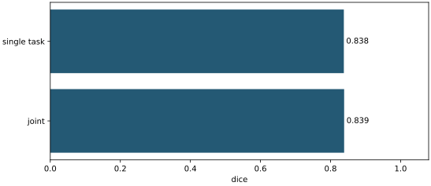

# Joint lesion segmentation and classification (simulation)

Held-out Dice for segmentation-only vs joint training was 0.8380 vs 0.8388 across three seeds. Joint-model size classification AUROC was 0.932.



## Study design

Compare a segmentation-only CNN with the same architecture trained jointly on segmentation and an image-level lesion-size category. The two outputs share an encoder. The auxiliary label is whether foreground area exceeds the median training-mask area. Models select checkpoints by validation Dice. An auxiliary AUROC is reported for the joint arm. Generate 480 RGB lesion phantoms with varying lesion areas and textures per seed.

Independent portfolio experiment inspired by work from Sanjana Mudduluru. [Research source](https://www.ou.edu/coe/cs/people/faculty/sanjana-mudduluru)

## Results

| Method | dice | test_images | size_auroc |
|---|---:|---:|---:|
| single task | 0.8380 | 86.0000 | — |
| joint | 0.8388 | 86.0000 | 0.9321 |

Per-seed results are in [results.json](results.json).

## Reproduce

Local CPU run, Python 3.10. Model checkpoints are generated during training. Set PORTFOLIO_DATA to reuse an existing data directory.

```sh
python -m pip install -r requirements.txt
python train.py
```

[Training notebook](reproduce.ipynb)
