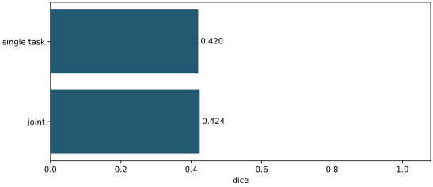

# Joint lesion segmentation and classification (public data)

Held-out Dice for segmentation-only vs joint training was 0.4198 vs 0.4241 across three seeds. Joint-model size classification AUROC was 0.502.



## Study design

Compare a segmentation-only CNN with the same architecture trained jointly on segmentation and an image-level lesion-size category. The two outputs share an encoder. The auxiliary label is whether foreground area exceeds the median training-mask area. Models select checkpoints by validation Dice. An auxiliary AUROC is reported for the joint arm. Use 520 Kvasir-SEG polyp images and masks at 40×40. Train and evaluate on disjoint images within each repeat. The auxiliary label measures polyp area, with no malignancy prediction. The task adapts the joint training idea in Mudduluru's work.

Independent portfolio experiment inspired by work from Sanjana Mudduluru. [Research source](https://www.ou.edu/coe/cs/people/faculty/sanjana-mudduluru)

[Public dataset](https://datasets.simula.no/kvasir-seg/)

## Results

| Method | dice | test_images | size_auroc |
|---|---:|---:|---:|
| single task | 0.4198 | 94.0000 | — |
| joint | 0.4241 | 94.0000 | 0.5018 |

Per-seed results are in [results.json](results.json).

## Reproduce

Local CPU run, Python 3.10. Model checkpoints are generated during training. Set PORTFOLIO_DATA to reuse an existing data directory.

```sh
python -m pip install -r requirements.txt
python prepare.py
python train.py
```

[Training notebook](reproduce.ipynb)
