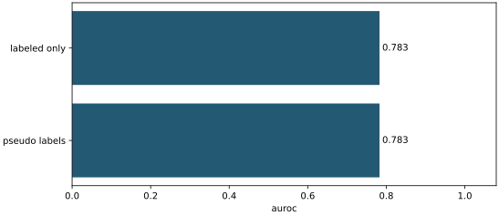

# Sleep–wake classification with sparse labels (simulation)

AUROC (labeled-only vs pseudo-label training): 0.7827 vs 0.7827, averaged over three seeds.



## Study design

Hold out one quarter of participants. Train a 96-tree forest with 10% of the training epochs labeled. Retrain after adding training-only pseudo-labels with probability below 0.08 or above 0.92. Metrics pool held-out epochs within each split. Generate 40 people with person-specific heart-rate baselines and switching wake/sleep states. Compute rolling summaries from the synthetic signal.

Independent portfolio experiment inspired by work from Prashant Shenoy. [Research source](https://lass.cs.umass.edu/projects/mobile-health.html)

## Results

| Method | auroc | average_precision | balanced_accuracy | test_subjects |
|---|---:|---:|---:|---:|
| labeled only | 0.7827 | 0.8907 | 0.6790 | 10.0000 |
| pseudo labels | 0.7827 | 0.8907 | 0.6790 | 10.0000 |

Per-seed results are in [results.json](results.json).

## Reproduce

Local CPU run, Python 3.10. Model checkpoints are generated during training. Set PORTFOLIO_DATA to reuse an existing data directory.

```sh
python -m pip install -r requirements.txt
python train.py
```

[Training notebook](reproduce.ipynb)
