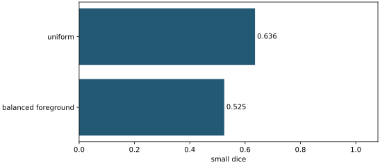

# Segmentation performance by lesion size (simulation)

Small-lesion Dice (uniform vs foreground-balanced sampling on small lesions): 0.636 vs 0.525, averaged over three seeds.



## Study design

Train two 48-tree pixel classifiers using RGB and local intensity features at 48 × 48 resolution. Compare uniform pixel sampling against equal foreground/background sampling. Each seed uses 400 training and 200 held-out images. Define small lesions using the median training-mask area and report image-level mean Dice in both strata. Each seed generates 600 RGB phantoms with variable disk radii, lesion contrast and pixel noise. The foreground mask is known exactly.

Independent portfolio experiment inspired by work from Yu Tian. [Research source](https://www.cecs.ucf.edu/faculty/yu-tian/)

## Results

| Method | small_dice | large_dice | all_dice |
|---|---:|---:|---:|
| uniform | 0.6358 | 0.9128 | 0.7796 |
| balanced foreground | 0.5246 | 0.8128 | 0.6749 |

Per-seed results are in [results.json](results.json).

## Reproduce

Local CPU run, Python 3.10. Model checkpoints are generated during training. Set PORTFOLIO_DATA to reuse an existing data directory.

```sh
python -m pip install -r requirements.txt
python train.py
```

[Training notebook](reproduce.ipynb)
