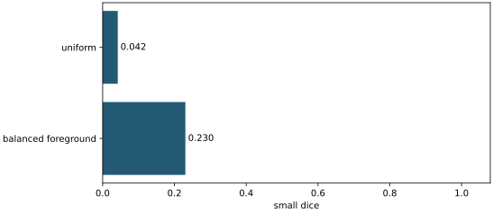

# Segmentation performance by lesion size (public data)

Small-lesion Dice (uniform vs foreground-balanced sampling on small lesions): 0.042 vs 0.230, averaged over three seeds.



## Study design

Train two 48-tree pixel classifiers using RGB and local intensity features at 48 × 48 resolution. Compare uniform pixel sampling against equal foreground/background sampling. Each seed uses 400 training and 200 held-out images. Define small lesions using the median training-mask area and report image-level mean Dice in both strata. The source has 1,000 Kvasir-SEG endoscopy image/mask pairs. Each seed samples 600 without replacement. Splits are at image level. Size strata describe lesion geometry. Demographic fairness and patient-level generalization were outside this experiment.

Independent portfolio experiment inspired by work from Yu Tian. [Research source](https://www.cecs.ucf.edu/faculty/yu-tian/)

[Public dataset](https://datasets.simula.no/kvasir-seg/)

## Results

| Method | small_dice | large_dice | all_dice |
|---|---:|---:|---:|
| uniform | 0.0421 | 0.0296 | 0.0351 |
| balanced foreground | 0.2304 | 0.5839 | 0.4227 |

Per-seed results are in [results.json](results.json).

## Reproduce

Local CPU run, Python 3.10. Model checkpoints are generated during training. Set PORTFOLIO_DATA to reuse an existing data directory.

```sh
python -m pip install -r requirements.txt
python prepare.py
python train.py
```

[Training notebook](reproduce.ipynb)
