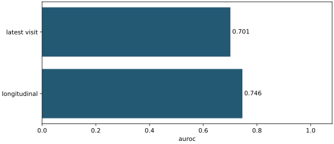

# Longitudinal imaging features for dementia risk (simulation)

AUROC for latest visit vs longitudinal features was 0.7010 vs 0.7458 across three seeds.



## Study design

Compare age and MRI-derived volumes at the prediction visit with the same features plus annualized changes since the prior visit. Evaluate regularized logistic regression on subject-level out-of-fold probabilities. Generate 900 simulated trajectories per seed. Event risk depends on current level and latent progression rate. Use five stratified folds.

Independent portfolio experiment inspired by work from Chengjun Liu. [Research source](https://people.njit.edu/profile/cliu)

## Results

| Method | auroc | average_precision | brier | subjects | events |
|---|---:|---:|---:|---:|---:|
| latest visit | 0.7010 | 0.5271 | 0.1895 | 900.0000 | 279.3333 |
| longitudinal | 0.7458 | 0.5869 | 0.1776 | 900.0000 | 279.3333 |

Per-seed results are in [results.json](results.json).

## Reproduce

Local CPU run, Python 3.10. Model checkpoints are generated during training. Set PORTFOLIO_DATA to reuse an existing data directory.

```sh
python -m pip install -r requirements.txt
python train.py
```

[Training notebook](reproduce.ipynb)
