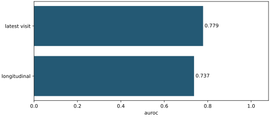

# Longitudinal imaging features for dementia risk (public data)

AUROC for latest visit vs longitudinal features was 0.7786 vs 0.7370 across three seeds. Exploratory cohort with 36 participants and four events.



## Study design

Compare age and MRI-derived volumes at the prediction visit with the same features plus annualized changes since the prior visit. Evaluate regularized logistic regression on subject-level out-of-fold probabilities. Use the official OASIS-2 demographic workbook. Require two visits with CDR zero followed by at least one subsequent assessment. The target is any subsequent CDR above zero during available follow-up. The cohort contains 36 eligible participants and only four events. Use four-fold stratification and treat estimates as exploratory. Features are derived from MRI summaries.

Independent portfolio experiment inspired by work from Chengjun Liu. [Research source](https://people.njit.edu/profile/cliu)

[Public dataset](https://sites.wustl.edu/oasisbrains/home/oasis-2/)

## Results

| Method | auroc | average_precision | brier | subjects | events |
|---|---:|---:|---:|---:|---:|
| latest visit | 0.7786 | 0.2891 | 0.0946 | 36.0000 | 4.0000 |
| longitudinal | 0.7370 | 0.2440 | 0.0962 | 36.0000 | 4.0000 |

Per-seed results are in [results.json](results.json).

## Reproduce

Local CPU run, Python 3.10. Model checkpoints are generated during training. Set PORTFOLIO_DATA to reuse an existing data directory.

```sh
python -m pip install -r requirements.txt
python prepare.py
python train.py
```

[Training notebook](reproduce.ipynb)
