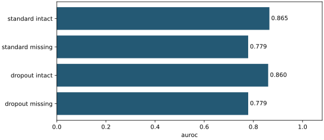

# Prediction under sensor loss (simulation)

AUROC (standard vs dropout training with missing sensors): 0.7786 vs 0.7788, averaged over three seeds.



## Study design

Hold out one quarter of participants. Train regularized logistic classifiers on intact measurements or on intact and masked copies. Test both models with all features and with the second sensor group replaced by the training mean. Compare AUROC under sensor loss. Generate paired measurements of shared latent signals for 32 subjects. The two sensor groups have different noise levels and subject-specific offsets.

Independent portfolio experiment inspired by work from Jinbo Bi. [Research source](https://jinbo-bi.uconn.edu/)

## Results

| Method | auroc | average_precision |
|---|---:|---:|
| standard intact | 0.8651 | 0.8621 |
| standard missing | 0.7786 | 0.7736 |
| dropout intact | 0.8601 | 0.8580 |
| dropout missing | 0.7788 | 0.7742 |

Per-seed results are in [results.json](results.json).

## Reproduce

Local CPU run, Python 3.10. Model checkpoints are generated during training. Set PORTFOLIO_DATA to reuse an existing data directory.

```sh
python -m pip install -r requirements.txt
python train.py
```

[Training notebook](reproduce.ipynb)
