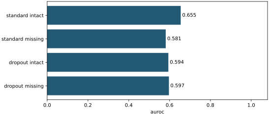

# Prediction under sensor loss (public data)

AUROC (standard vs dropout training with missing sensors): 0.5811 vs 0.5967, averaged over three seeds. With intact sensors, AUROC changed from 0.655 to 0.594.



## Study design

Hold out one quarter of participants. Train regularized logistic classifiers on intact measurements or on intact and masked copies. Test both models with all features and with the second sensor group replaced by the training mean. Compare AUROC under sensor loss. Use PhysioNet EEG motor imagery runs 4 and 8 for subjects 1–16. Extract log band power from eighteen electrodes in three bands and re-reference each side independently. The target is imagined left versus right fist. Withholding right-side sensors tests missing-view robustness on a behavioral task.

Independent portfolio experiment inspired by work from Jinbo Bi. [Research source](https://jinbo-bi.uconn.edu/)

[Public dataset](https://physionet.org/content/eegmmidb/1.0.0/)

## Results

| Method | auroc | average_precision |
|---|---:|---:|
| standard intact | 0.6545 | 0.6238 |
| standard missing | 0.5811 | 0.5653 |
| dropout intact | 0.5939 | 0.6054 |
| dropout missing | 0.5967 | 0.6038 |

Per-seed results are in [results.json](results.json).

## Reproduce

Local CPU run, Python 3.10. Model checkpoints are generated during training. Set PORTFOLIO_DATA to reuse an existing data directory.

```sh
python -m pip install -r requirements.txt
python prepare.py
python train.py
```

[Training notebook](reproduce.ipynb)
