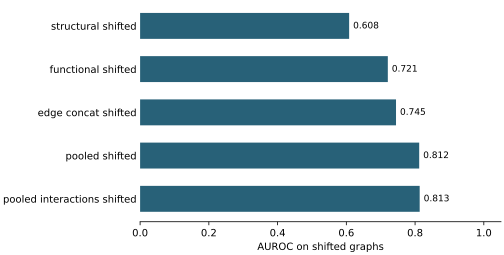

# Structural and functional brain graph fusion

Can averaging connections within known modules recover signal that is hard to learn from individual edges?

## Result

On shifted graphs, raw edge fusion reached 0.745 AUROC. Pooling by module reached 0.812, and adding cross-modal interactions reached 0.813. The simulator supplies the module labels and embeds signal at that scale. The result measures the value of that prior in this setting.



## Experiment

Five seeds each generate 2,500 training, 600 validation and 900 held-out pairs of 24-node graphs. One graph records simulated connection counts and the other comes from correlations between regional time series. Five feature sets are compared. Validation Brier score selects regularization separately for each. The stress test perturbs count rates and signal noise.

Independent portfolio project connected to [Liu and colleagues’ DICCCOL study of structural and functional cortical architecture](https://pmc.ncbi.nlm.nih.gov/articles/PMC3593574/).

## Held-out metrics

| Method and condition | auroc | brier |
|---|---:|---:|
| structural clean | 0.6231 | 0.2412 |
| structural shifted | 0.6082 | 0.2467 |
| functional clean | 0.7349 | 0.2103 |
| functional shifted | 0.7207 | 0.2226 |
| edge concat clean | 0.7620 | 0.2029 |
| edge concat shifted | 0.7445 | 0.2126 |
| pooled clean | 0.8088 | 0.1760 |
| pooled shifted | 0.8120 | 0.1805 |
| pooled interactions clean | 0.8120 | 0.1744 |
| pooled interactions shifted | 0.8134 | 0.1823 |

Individual seeds or folds and the evaluation details are in [results.json](results.json).

## Reproduce

Run in this folder with Python 3.10.11. The original runs used a local CPU. Model parameters are saved to the checkpoints directory on training.

```sh
python -m pip install -r requirements.txt
python train.py
```

[Open the reproduction notebook](reproduce.ipynb) · [Training source](train.py)
