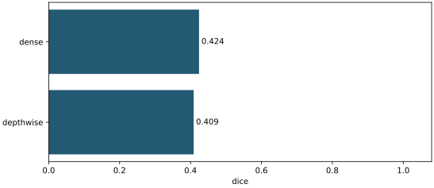

# Efficient multiscale segmentation (public data)

Dice for dense vs multiscale decoder was 0.424 vs 0.409 across three seeds. Parameters: 15,353 vs 7,393.



## Study design

Compare a dense segmentation decoder with an original efficient decoder using parallel 3×3 and 5×5 depthwise convolutions and channel gating. Both use the same encoder, skip fusion, BCE plus soft Dice objective and validation-based epoch selection. Train from scratch for nine epochs for each of three seeds. The experiment takes the multiscale depthwise and attention ideas from EMCAD and uses a smaller custom architecture. Use a fixed sample of 520 Kvasir-SEG RGB images and masks at 40×40 resolution. Train, validate and test on disjoint images within each repeat. Test sets can overlap across seeds. The study reports the accuracy and parameter trade-off for this CPU-scale experiment.

Independent portfolio experiment inspired by work from Md Mostafijur Rahman. [Research source](https://openaccess.thecvf.com/content/CVPR2024/html/Rahman_EMCAD_Efficient_Multi-scale_Convolutional_Attention_Decoding_for_Medical_Image_Segmentation_CVPR_2024_paper.html)

[Public dataset](https://datasets.simula.no/kvasir-seg/)

## Results

| Method | dice | parameters | test_images |
|---|---:|---:|---:|
| dense | 0.4240 | 15353.0000 | 94.0000 |
| depthwise | 0.4087 | 7393.0000 | 94.0000 |

Per-seed results are in [results.json](results.json).

## Reproduce

Local CPU run, Python 3.10. Model checkpoints are generated during training. Set PORTFOLIO_DATA to reuse an existing data directory.

```sh
python -m pip install -r requirements.txt
python prepare.py
python train.py
```

[Training notebook](reproduce.ipynb)
