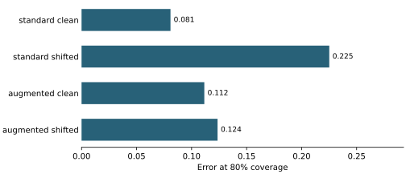

# Selective pneumonia classification on chest X-rays

How much does augmentation help a CNN when it can defer the least confident X-rays?

## Result

At 80% coverage, error on corrupted X-rays fell from 22.5% to 12.4% with augmentation. Clean-image error rose from 8.1% to 11.2%. The corrupted test uses simulated blur, gain and noise on the same X-rays. This measures robustness to that perturbation within one dataset.



## Experiment

The official split contains 4,708 training, 524 validation and 624 test images at 28 × 28 pixels. Three seeds train two three-block CNNs for 12 epochs each. Clean validation Brier score selects the checkpoint. All arms see the same test images and the same fixed corruption. Coverage is calculated separately for each model and test condition.

Independent portfolio project connected to [Zhou’s Stanford AIMI talk on robustness in medical image analysis](https://aimi.stanford.edu/events/research-meeting/aimi-research-meeting-rethink-robustness-deep-learning-models-medical-image).

Data and attribution: [PneumoniaMNIST, MedMNIST v2](https://zenodo.org/records/10519652).

## Held-out metrics

| Method and condition | auroc | brier | aurc | risk at 50 | risk at 80 | risk at 100 |
|---|---:|---:|---:|---:|---:|---:|
| standard clean | 0.9489 | 0.1127 | 0.0523 | 0.0524 | 0.0808 | 0.1405 |
| standard shifted | 0.8052 | 0.1984 | 0.1720 | 0.1709 | 0.2251 | 0.2703 |
| augmented clean | 0.9389 | 0.1452 | 0.0736 | 0.0556 | 0.1116 | 0.1779 |
| augmented shifted | 0.9201 | 0.1485 | 0.0878 | 0.0630 | 0.1236 | 0.1886 |

Individual seeds or folds and the evaluation details are in [results.json](results.json).

## Reproduce

Run in this folder with Python 3.10.11. The original runs used a local CPU. Model parameters are saved to the checkpoints directory on training.

```sh
python -m pip install -r requirements.txt
python download.py
python train.py --data data/pneumoniamnist.npz
```

[Open the reproduction notebook](reproduce.ipynb) · [Training source](train.py)
