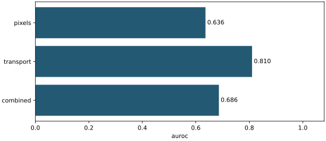

# Projection-based transport morphometry (simulation)

Held-out AUROC (pixels vs pixels plus transport features): 0.636 vs 0.686, averaged over three seeds.



## Study design

Compare regularized logistic classification using raw pixels, sliced intensity-mass quantiles, or their concatenation. Construct 24 quantiles along each of 12 angles. Use stratified 85% training subsamples and compare all arms on the same test images. Each seed generates 1,800 training and 600 held-out images with class-dependent shape and texture. Intensities form synthetic spatial distributions.

Independent portfolio experiment inspired by work from Gustavo Kunde Rohde. [Research source](https://engineering.virginia.edu/faculty/gustavo-kunde-rohde)

## Results

| Method | auroc | balanced_accuracy |
|---|---:|---:|
| pixels | 0.6360 | 0.6421 |
| transport | 0.8102 | 0.7425 |
| combined | 0.6862 | 0.6800 |

Per-seed results are in [results.json](results.json).

## Reproduce

Local CPU run, Python 3.10. Model checkpoints are generated during training. Set PORTFOLIO_DATA to reuse an existing data directory.

```sh
python -m pip install -r requirements.txt
python train.py
```

[Training notebook](reproduce.ipynb)
