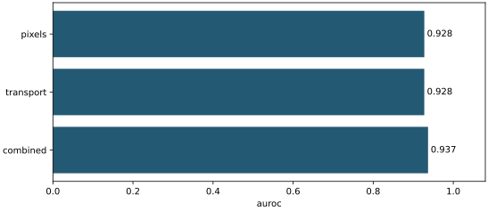

# Projection-based transport morphometry (public data)

Held-out AUROC (pixels vs pixels plus transport features): 0.928 vs 0.937, averaged over three seeds.



## Study design

Compare regularized logistic classification using raw pixels, sliced intensity-mass quantiles, or their concatenation. Construct 24 quantiles along each of 12 angles. Use stratified 85% training subsamples and compare all arms on the same test images. PneumoniaMNIST supplies 4,708 training and 624 official test chest X-rays. Different subsamples share one test set. Transport features summarize intensity mass, which can reflect exposure as well as anatomy.

Independent portfolio experiment inspired by work from Gustavo Kunde Rohde. [Research source](https://engineering.virginia.edu/faculty/gustavo-kunde-rohde)

[Public dataset](https://zenodo.org/records/10519652)

## Results

| Method | auroc | balanced_accuracy |
|---|---:|---:|
| pixels | 0.9276 | 0.8031 |
| transport | 0.9275 | 0.8225 |
| combined | 0.9370 | 0.8131 |

Per-seed results are in [results.json](results.json).

## Reproduce

Local CPU run, Python 3.10. Model checkpoints are generated during training. Set PORTFOLIO_DATA to reuse an existing data directory.

```sh
python -m pip install -r requirements.txt
python prepare.py
python train.py
```

[Training notebook](reproduce.ipynb)
