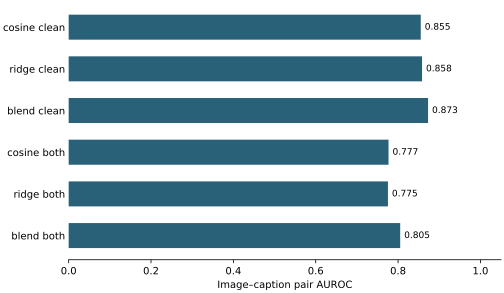

# Radiology image–caption pair verification

Can paired radiology examples teach a frozen image–text model to recognize matching captions?

## Result

On clean pairs, the trained blend raised AUROC from 0.855 to 0.873 and bidirectional Recall@5 from 48.1% to 52.3%. Average precision fell from 0.118 to 0.108. Pair labels identify the original caption. Different captions can still describe clinically similar images.



## Experiment

The experiment reuses frozen CLIP embeddings for 200 training and 80 official test pairs from the Radiology_mini subset of ROCOv2. Five 150/50 train/validation partitions select ridge strength and blend weight by average precision, then the maps refit on all 200 training pairs. Each test grid contains 80 positives and 6,320 off-diagonal negatives. All five fits share one test gallery. Blur and word dropout provide three stress conditions.

Independent portfolio project connected to [Ye’s retinal image-captioning work, GCS-M3VLT](https://sites.google.com/view/donghyeye).

Data and attribution: [Radiology_mini dataset and license](https://huggingface.co/datasets/unsloth/Radiology_mini) · [OpenAI CLIP model](https://huggingface.co/openai/clip-vit-base-patch32).

## Held-out metrics

| Method and condition | pair auroc | average precision | recall at 5 |
|---|---:|---:|---:|
| cosine clean | 0.8551 | 0.1184 | 0.4813 |
| ridge clean | 0.8582 | 0.0951 | 0.4675 |
| blend clean | 0.8729 | 0.1079 | 0.5225 |
| cosine blur | 0.8287 | 0.0969 | 0.4688 |
| ridge blur | 0.8337 | 0.0843 | 0.4313 |
| blend blur | 0.8533 | 0.0987 | 0.4963 |
| cosine dropout | 0.8112 | 0.0794 | 0.3875 |
| ridge dropout | 0.8002 | 0.0730 | 0.3337 |
| blend dropout | 0.8281 | 0.0823 | 0.4138 |
| cosine both | 0.7768 | 0.0802 | 0.3938 |
| ridge both | 0.7754 | 0.0616 | 0.3275 |
| blend both | 0.8052 | 0.0782 | 0.4037 |

Individual seeds or folds and the evaluation details are in [results.json](results.json).

## Reproduce

Run in this folder with Python 3.10.11. The original runs used a local CPU. Model parameters are saved to the checkpoints directory on training.

```sh
python -m pip install -r requirements.txt
python prepare.py
python train.py --embeddings data/roco_clip_embeddings.npz
```

[Open the reproduction notebook](reproduce.ipynb) · [Training source](train.py)
