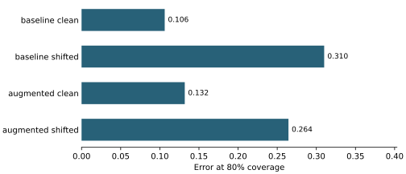

# Selective prediction under simulated image shift

Does training with corrupted images reduce error among the cases a classifier accepts?

## Result

Under simulated shift, augmentation reduced error at 80% coverage from 31.0% to 26.4%. On clean images, that error increased from 10.6% to 13.2%. Results describe the simulated signal and corruption family.



## Experiment

Five independently generated datasets each contain 3,200 training images and 1,200 held-out 16 × 16 images. Two standardized logistic models see clean data or paired clean and corrupted data. Blur, gain and noise perturb the test images. Each model accepts the most confident 80% using distance from probability 0.5.

Independent portfolio project connected to [Zhou’s Stanford AIMI talk on robustness in medical image analysis](https://aimi.stanford.edu/events/research-meeting/aimi-research-meeting-rethink-robustness-deep-learning-models-medical-image).

## Held-out metrics

| Method and condition | auroc | aurc | risk at 80 percent |
|---|---:|---:|---:|
| baseline clean | 0.9133 | 0.0601 | 0.1062 |
| baseline shifted | 0.7218 | 0.2547 | 0.3100 |
| augmented clean | 0.9180 | 0.0715 | 0.1319 |
| augmented shifted | 0.7683 | 0.1923 | 0.2644 |

Individual seeds or folds and the evaluation details are in [results.json](results.json).

## Reproduce

Run in this folder with Python 3.10.11. The original runs used a local CPU. Model parameters are saved to the checkpoints directory on training.

```sh
python -m pip install -r requirements.txt
python train.py
```

[Open the reproduction notebook](reproduce.ipynb) · [Training source](train.py)
