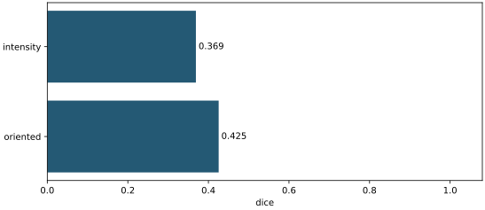

# Orientation-aware thin structure segmentation (simulation)

Held-out Dice for intensity vs orientation channels was 0.3689 vs 0.4255 across three seeds.



## Study design

Compare the same compact convolutional segmenter on intensity alone and intensity plus six steerable second-derivative channels. Synthesize responses at six angles from Gaussian Hessian components. Both models use the same mask loss and best-validation-Dice epoch selection. The design adapts the orientation-aware detection idea in Li and Barbu. It uses fixed steerable filters and a conventional CNN. Generate 400 noisy images of narrow curved tracks at varied orientations, widths and contrasts per seed.

Independent portfolio experiment inspired by work from Adrian Barbu. [Research source](https://ani.stat.fsu.edu/~abarbu/papers/2020-SteerableCNN-CVPR.pdf)

## Results

| Method | dice | test_images | mask_prevalence |
|---|---:|---:|---:|
| intensity | 0.3689 | 72.0000 | 0.0480 |
| oriented | 0.4255 | 72.0000 | 0.0480 |

Per-seed results are in [results.json](results.json).

## Reproduce

Local CPU run, Python 3.10. Model checkpoints are generated during training. Set PORTFOLIO_DATA to reuse an existing data directory.

```sh
python -m pip install -r requirements.txt
python train.py
```

[Training notebook](reproduce.ipynb)
