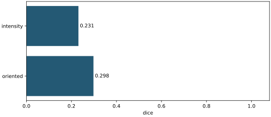

# Orientation-aware thin structure segmentation (public data)

Held-out Dice for intensity vs orientation channels was 0.2311 vs 0.2978 across three seeds.



## Study design

Compare the same compact convolutional segmenter on intensity alone and intensity plus six steerable second-derivative channels. Synthesize responses at six angles from Gaussian Hessian components. Both models use the same mask loss and best-validation-Dice epoch selection. The design adapts the orientation-aware detection idea in Li and Barbu. It uses fixed steerable filters and a conventional CNN. Use the public DRIVE retinal fundus data with vessel labels. Train on 16 images and validate on four from the original training partition. Evaluate on 20 separate test images at 144×144. Retinal vessels are thin structures and serve as an accessible analogue for guidewires.

Independent portfolio experiment inspired by work from Adrian Barbu. [Research source](https://ani.stat.fsu.edu/~abarbu/papers/2020-SteerableCNN-CVPR.pdf)

[Public dataset](https://drive.grand-challenge.org/)

## Results

| Method | dice | test_images | mask_prevalence |
|---|---:|---:|---:|
| intensity | 0.2311 | 20.0000 | 0.0876 |
| oriented | 0.2978 | 20.0000 | 0.0876 |

Per-seed results are in [results.json](results.json).

## Reproduce

Local CPU run, Python 3.10. Model checkpoints are generated during training. Set PORTFOLIO_DATA to reuse an existing data directory.

```sh
python -m pip install -r requirements.txt
python prepare.py
python train.py
```

[Training notebook](reproduce.ipynb)
