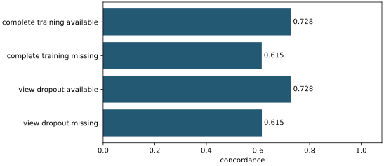

# Missing-view survival prediction (simulation)

Harrell concordance (ordinary training vs view dropout with one view withheld): 0.615 vs 0.615, averaged over three seeds.



## Study design

Fit discrete-time logistic hazards across six intervals, with and without duplicating training records after masking the second feature group. Test on complete and masked inputs. Score one-year predicted risk using Harrell concordance across all comparable follow-up pairs. Each seed creates 2,600 records with independent exponential censoring and event times influenced by both feature groups. The holdout is 30%.

Independent portfolio experiment inspired by work from Junzhou Huang. [Research source](https://ranger.uta.edu/~huang/Publication.htm)

## Results

| Method | concordance | comparable_pairs |
|---|---:|---:|
| complete training available | 0.7278 | 197670.0000 |
| complete training missing | 0.6146 | 197670.0000 |
| view dropout available | 0.7282 | 197670.0000 |
| view dropout missing | 0.6150 | 197670.0000 |

Per-seed results are in [results.json](results.json).

## Reproduce

Local CPU run, Python 3.10. Model checkpoints are generated during training. Set PORTFOLIO_DATA to reuse an existing data directory.

```sh
python -m pip install -r requirements.txt
python train.py
```

[Training notebook](reproduce.ipynb)
