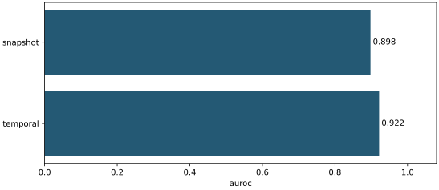

# Temporal risk ranking for hypotension (simulation)

AUROC for snapshot vs temporal summaries was 0.898 vs 0.922 across three seeds.



## Study design

Compare gradient boosting on a snapshot of six latest vitals with a model that adds each vital's minimum, mean, variation, slope and observation count. Hold out 25% of stays per seed and evaluate AUROC, average precision and recall in the top 10% of risk scores. This transfers the time-bounded EHR risk-ranking idea from Wiens's CDI study to a different outcome. Generate simulated vital signs from latent pressure levels and slopes. Predict a later low arterial pressure observation.

Independent portfolio experiment inspired by work from Jenna Wiens. [Research source](https://pmc.ncbi.nlm.nih.gov/articles/PMC6421072/)

## Results

| Method | auroc | average_precision | recall_top_10pct | eligible_stays | events |
|---|---:|---:|---:|---:|---:|
| snapshot | 0.8979 | 0.4251 | 0.5272 | 2647.3333 | 197.0000 |
| temporal | 0.9217 | 0.5123 | 0.5873 | 2647.3333 | 197.0000 |

Per-seed results are in [results.json](results.json).

## Reproduce

Local CPU run, Python 3.10. Model checkpoints are generated during training. Set PORTFOLIO_DATA to reuse an existing data directory.

```sh
python -m pip install -r requirements.txt
python train.py
```

[Training notebook](reproduce.ipynb)
