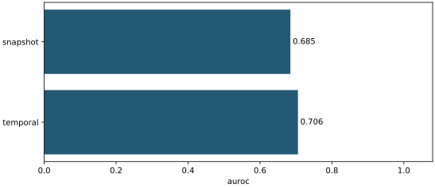

# Temporal risk ranking for hypotension (public data)

AUROC for snapshot vs temporal summaries was 0.685 vs 0.706 across three seeds. The cohort had 2,608 eligible stays.



## Study design

Compare gradient boosting on a snapshot of six latest vitals with a model that adds each vital's minimum, mean, variation, slope and observation count. Hold out 25% of stays per seed and evaluate AUROC, average precision and recall in the top 10% of risk scores. This transfers the time-bounded EHR risk-ranking idea from Wiens's CDI study to a different outcome. Use public PhysioNet Challenge 2012 Set A. Exclude stays with observed systolic pressure below 90 mmHg before the six-hour landmark. Require at least one systolic measurement on each side of the landmark. Use only measurements through hour six as predictors, and define the target as any observed systolic reading below 90 mmHg during hours 6–12. The outcome depends on recorded measurements and the splits are retrospective.

Independent portfolio experiment inspired by work from Jenna Wiens. [Research source](https://pmc.ncbi.nlm.nih.gov/articles/PMC6421072/)

[Public dataset](https://physionet.org/content/challenge-2012/1.0.0/)

## Results

| Method | auroc | average_precision | recall_top_10pct | eligible_stays | events |
|---|---:|---:|---:|---:|---:|
| snapshot | 0.6845 | 0.2980 | 0.2061 | 2608.0000 | 441.0000 |
| temporal | 0.7056 | 0.3450 | 0.2606 | 2608.0000 | 441.0000 |

Per-seed results are in [results.json](results.json).

## Reproduce

Local CPU run, Python 3.10. Model checkpoints are generated during training. Set PORTFOLIO_DATA to reuse an existing data directory.

```sh
python -m pip install -r requirements.txt
python prepare.py
python train.py
```

[Training notebook](reproduce.ipynb)
