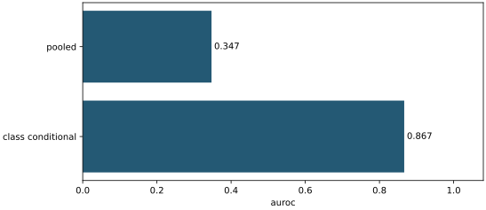

# Tissue novelty detection (simulation)

AUROC (pooled vs class-specific covariance): 0.3472 vs 0.8667, averaged over three seeds.



## Study design

Reduce features to 24 principal components using known classes only. Fit one shrinkage covariance model to all known examples, then one per known class. Compare pooled Mahalanobis distance with distance to the closest class. A larger score indicates a more unusual sample. Nine simulated tissue classes generate noisy 40-dimensional features. The withheld ninth class lies between two known class centers. Generate independent training and test samples for each seed.

Independent portfolio experiment inspired by work from Sheng Wang. [Research source](https://www.cs.washington.edu/people/faculty/sheng-wang/)

## Results

| Method | auroc | average_precision |
|---|---:|---:|
| pooled | 0.3472 | 0.0832 |
| class conditional | 0.8667 | 0.5251 |

Per-seed results are in [results.json](results.json).

## Reproduce

Local CPU run, Python 3.10. Model checkpoints are generated during training. Set PORTFOLIO_DATA to reuse an existing data directory.

```sh
python -m pip install -r requirements.txt
python train.py
```

[Training notebook](reproduce.ipynb)
