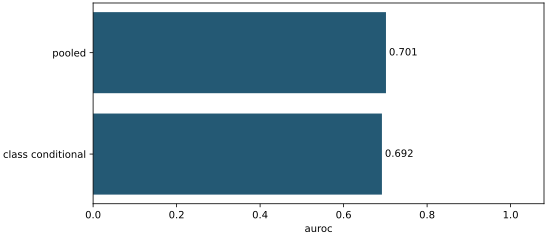

# Tissue novelty detection (public data)

AUROC (pooled vs class-specific covariance): 0.7015 vs 0.6918, averaged over three seeds.



## Study design

Reduce features to 24 principal components using known classes only. Fit one shrinkage covariance model to all known examples, then one per known class. Compare pooled Mahalanobis distance with distance to the closest class. A larger score indicates a more unusual sample. Use up to 650 training tiles per known class and the official PathMNIST test set. Class 8 (colorectal adenocarcinoma epithelium) is excluded from training and is the positive class at test. Features summarize spatial color and multiscale texture. This is novelty detection for one withheld tissue type.

Independent portfolio experiment inspired by work from Sheng Wang. [Research source](https://www.cs.washington.edu/people/faculty/sheng-wang/)

[Public dataset](https://medmnist.com/)

## Results

| Method | auroc | average_precision |
|---|---:|---:|
| pooled | 0.7015 | 0.3344 |
| class conditional | 0.6918 | 0.3049 |

Per-seed results are in [results.json](results.json).

## Reproduce

Local CPU run, Python 3.10. Model checkpoints are generated during training. Set PORTFOLIO_DATA to reuse an existing data directory.

```sh
python -m pip install -r requirements.txt
python prepare.py
python train.py
```

[Training notebook](reproduce.ipynb)
