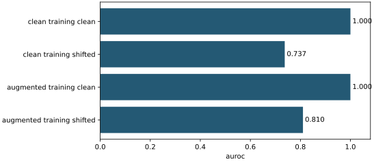

# Ultrasound classification under acquisition shift (simulation)

Shifted AUROC (clean vs augmented training on degraded test images): 0.737 vs 0.810, averaged over three seeds.



## Study design

Train two 160-tree classifiers on pixel intensities. Compare clean training with training on clean and randomly degraded images. Evaluate on the same clean and perturbed test cases. The perturbation changes gain, blur and noise. Each seed generates 1,800 training and 600 held-out phantoms with class-dependent shape and texture. Noise augmentation and test corruption come from overlapping families.

Independent portfolio experiment inspired by work from Ankita Shukla. [Research source](https://www.unr.edu/nevada-today/news/2026/medical-ai-research-project)

## Results

| Method | auroc | balanced_accuracy |
|---|---:|---:|
| clean training clean | 1.0000 | 0.9989 |
| clean training shifted | 0.7374 | 0.5144 |
| augmented training clean | 0.9998 | 0.9928 |
| augmented training shifted | 0.8102 | 0.7439 |

Per-seed results are in [results.json](results.json).

## Reproduce

Local CPU run, Python 3.10. Model checkpoints are generated during training. Set PORTFOLIO_DATA to reuse an existing data directory.

```sh
python -m pip install -r requirements.txt
python train.py
```

[Training notebook](reproduce.ipynb)
