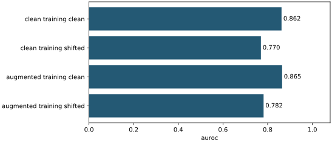

# Ultrasound classification under acquisition shift (public data)

Shifted AUROC (clean vs augmented training on degraded test images): 0.770 vs 0.782, averaged over three seeds.



## Study design

Train two 160-tree classifiers on pixel intensities. Compare clean training with training on clean and randomly degraded images. Evaluate on the same clean and perturbed test cases. The perturbation changes gain, blur and noise. BreastMNIST has 546 training and 156 official test ultrasound images at 28 × 28 resolution. The positive label combines normal and benign cases. All three fits share one test set. The acquisition shift is simulated.

Independent portfolio experiment inspired by work from Ankita Shukla. [Research source](https://www.unr.edu/nevada-today/news/2026/medical-ai-research-project)

[Public dataset](https://zenodo.org/records/10519652)

## Results

| Method | auroc | balanced_accuracy |
|---|---:|---:|
| clean training clean | 0.8622 | 0.7178 |
| clean training shifted | 0.7698 | 0.6207 |
| augmented training clean | 0.8647 | 0.7153 |
| augmented training shifted | 0.7818 | 0.6355 |

Per-seed results are in [results.json](results.json).

## Reproduce

Local CPU run, Python 3.10. Model checkpoints are generated during training. Set PORTFOLIO_DATA to reuse an existing data directory.

```sh
python -m pip install -r requirements.txt
python prepare.py
python train.py
```

[Training notebook](reproduce.ipynb)
